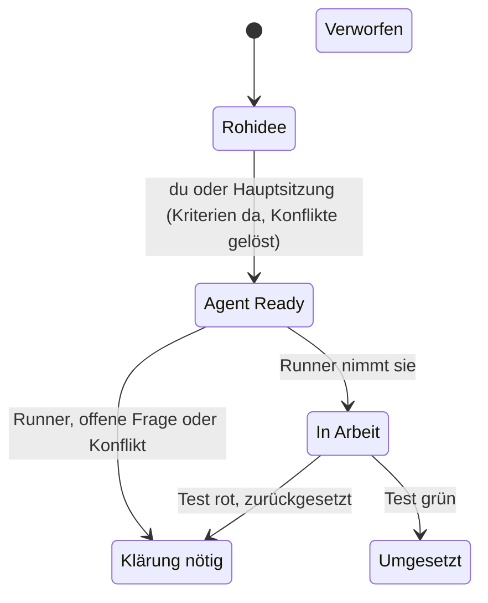
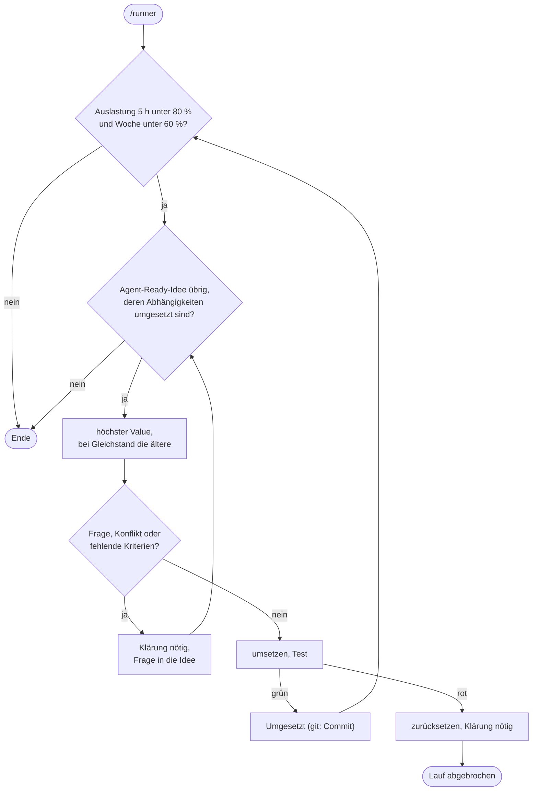

# Ideen — Backlog

**Eine Idee pro Datei**, nummeriert wie die ADRs: `NNNN-kebab-case.md`, vier Stellen, nie
umnummeriert, neue Ideen bekommen die nächste freie Nummer. Ideen sind lebendige Dokumente.
Sobald etwas **entschieden** ist, kommt es als ADR nach [../adrs/](../adrs/) und wird hier nur
verlinkt.

**Schnell ablegen geht vor Vollständigkeit:** Eine Rohidee darf aus Titel, Kopf und ein paar
Stichpunkten bestehen.

## Wie der Backlog funktioniert

- `Value` (0–10, 10 = am wertvollsten) und `Agent Ready` setzt **du oder die Hauptsitzung** ([ADR 0002](../adrs/0002-main-session-directs-the-backlog.md)).
  Die Hauptsitzung tut das nur, wenn keine Frage offen ist, sonst fragt sie. Sie schreibt keinen Code.
- Vor `Agent Ready` braucht die Idee **Akzeptanzkriterien** („Was ist fertig?“), und
  alle Konflikte sind gelöst (`Konflikte: ADR … (…) — gelöst: …`).
- Der **Runner** (zweites Terminal, `/runner`, [ADR 0001](../adrs/0001-idea-backlog-with-runner-agent.md)) nimmt die Agent-Ready-Idee mit dem höchsten
  Value. Bei Gleichstand nimmt er die ältere. Er arbeitet eine nach der anderen, bis keine mehr übrig ist.
  Protokoll: [RUNNER.md](RUNNER.md).
- Der Runner entscheidet nichts und schreibt keine ADRs. Bei offenen Fragen, Konflikten oder
  fehlenden Kriterien setzt er `Klärung nötig` und schreibt die Frage in die Idee. Ist der Test
  rot, setzt er seine Änderungen zurück und bricht den Lauf ab.
- Jede fertige Idee wird ein eigener git-Commit (`Idee NNNN: …`); pushen machst du.
- Eine Idee, die von einer unfertigen Idee abhängt, wird übersprungen.
- Vor jeder neuen Idee prüft er die Auslastung (5 h unter 80 %, Woche unter 60 %), damit für
  die Hauptsitzung genug übrig bleibt.

**Status:** Rohidee → Agent Ready → In Arbeit → Umgesetzt · außerdem Klärung nötig, Verworfen.



Ein Lauf des Runners:



---

## Agent Ready

| # | Idee | Value | Hinweis |
|---|---|---|---|
| [0001](0001-verpflegung.md) | Verpflegung — eigenes Essen neben den Buden | 6 | eigene Sektion + Packlisten-Kategorie |

## In Arbeit

| # | Idee | Value | Seit |
|---|---|---|---|

## Klärung nötig

| # | Idee | Value | Frage |
|---|---|---|---|

## Rohideen

| # | Idee | Value | Hinweis |
|---|---|---|---|

## Umgesetzt

| # | Idee | Value | Datum · Ergebnis |
|---|---|---|---|

## Verworfen

| # | Idee | Grund |
|---|---|---|

---

## Hintergrund (kein Backlog)

| Datei | Inhalt |
|---|---|
| [RUNNER.md](RUNNER.md) | Protokoll des Runner-Agenten (in allen Projekten gleich) |

## Vorlage

```markdown
# NNNN: Titel der Idee

Status: Rohidee · Value: – · Stand: YYYY-MM-DD
Quelle: Diktat YYYY-MM-DD / ADR … / Runner, YYYY-MM-DD, bei Idee NNNN
Berührt: – (Dateien, die eine Umsetzung ändert, z. B. index.html)
Konflikte: – (z. B. ADR 0002 (…) — gelöst: …)
Hängt ab von: – (z. B. Idee 0006)

## Idee

## Akzeptanzkriterien

(fehlt — vor „Agent Ready“ eintragen)

## Offene Fragen

## Umsetzung

(trägt der Runner ein)
```
